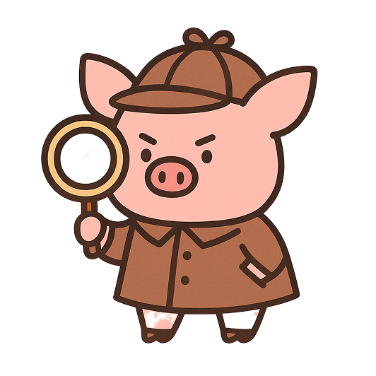
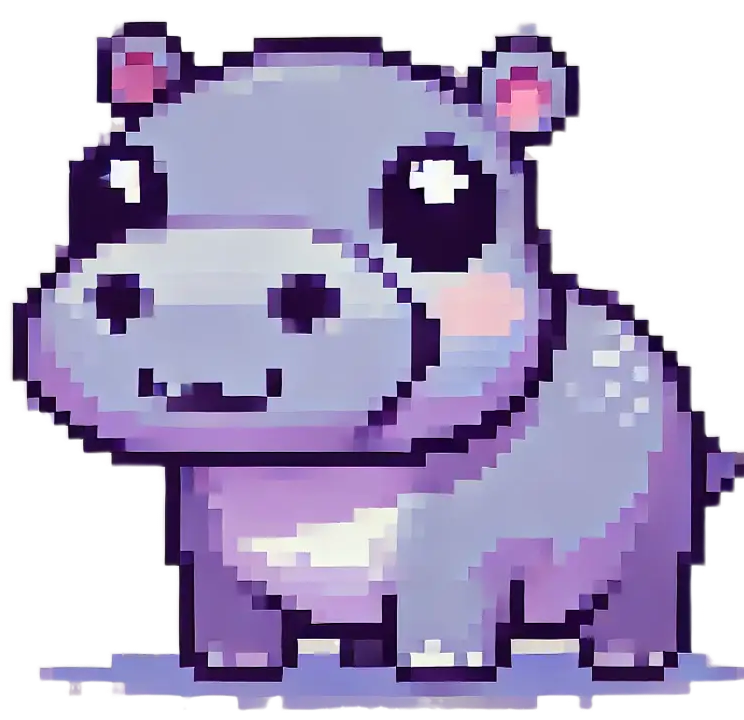

## About Me

I am a final-year M.S. student in the <b>[Data & Language Intelligence (DLI) Lab](https://dli.yonsei.ac.kr)</b> at [Yonsei University](https://www.yonsei.ac.kr/sc/index.jsp), advised by Prof. <b>[Dongha Lee](https://donalee.github.io/)</b>. Previously, I received my B.S. in Computer Science from [Yonsei University](https://www.yonsei.ac.kr/sc/index.jsp). 

If you're interested in collaborating on research or exploring new ideas together, please feel free to connect with me anytime!

---

## Research Interest

I aim to build human-supportive AI that can understand and assist people in dynamic, real-world environments. During my master’s, I explored how (M)LLMs can leverage long-term multimodal context across several directions, including:

- <b>personalization</b> in text-to-image generation and video highlight detection
- agentic frameworks that simulate real-world user behaviors for <b>proactive assistance</b>
- personalized <b>embodied agent</b> that leverage long-term human-agent interactions for instruction understanding and planning

More recently, I have become interested in how AI agents can learn from continuous input streams to build persistent knowledge about users and the world. In particular, I am interested in:

- <b>wearable AI</b> that integrates diverse sensors and signals to better understand users and their context
- <b>embodied AI</b> that builds and updates persistent world knowledge over time for reasoning, planning, and action

---
jeongeunn.github.io/index.md
## News

  
2026

  
Jun <b>PIGReward</b> is accepted to ECCV 2026 🇸🇪

  
May New preprint is out: <b><a href="https://arxiv.org/abs/2605.26256">POLAR</a></b>.

  
2025

  
Sep <b>CSI</b> is accepted to EMNLP Findings 2025 🇨🇳

  
Jul <b>HIPPO-VIDEO</b> is accepted to COLM 2025 🇨🇦

  
2024

  
Jul New preprint is out: <b><a href="https://arxiv.org/abs/2407.12374">CGSP</a></b>.

  
Feb Re-Ex is accepted to ICLR 2024 Workshop on Reliable and Responsible Foundation Models.

---


